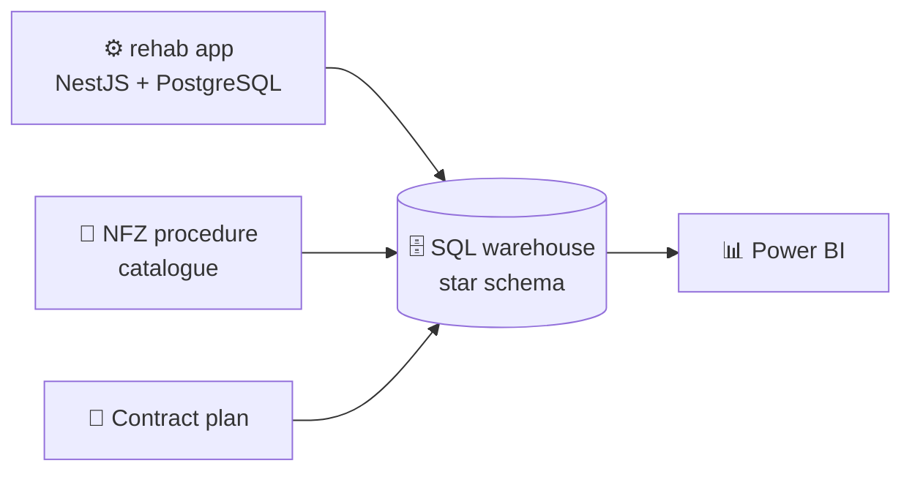

<h1 align="center">Hi, I'm Rafał 👋</h1>
<h3 align="center">I turn healthcare finance data into Power BI reports 📊🏥</h3>

  
  
  

---

### 🙋‍♂️ About me

- 🏥 I work in the finance department of a rehabilitation clinic: procedure billing and **NFZ contract** fulfilment
- 📊 I'm building **Power BI** reports on top of my own **SQL data warehouse**
- 🛠️ On the side I write the app that will feed that warehouse (NestJS + PostgreSQL)
- 💬 Ask me about: contract points, no-show rates, star schemas, or why a visit with an X-ray takes 45 minutes

### 🧰 Tech I use

  
  
  

### 🚀 Projects

| | Project | In one line |
|:-:|---|---|
| 📊 | [**rehab-contract-dashboard**](https://github.com/Rafalk88/rehab-contract-dashboard) | Power BI: contract fulfilment, clinic workload, no-shows. Star schema in PostgreSQL, synthetic data. 🚧 Dec 2026 |
| 📘 | [**rehab-module**](https://github.com/Rafalk88/rehab-module) | Main docs of a web app for rehab clinics: modules, roles, security |
| ⚙️ | [**rehab-backend**](https://github.com/Rafalk88/rehab-backend) | NestJS, PostgreSQL + Prisma, encrypted medical data, audit log |
| 🖥️ | [**rehab-frontend**](https://github.com/Rafalk88/rehab-frontend) | Next.js, React, Ant Design |

### 🔗 How it fits together

### 🌱 Right now

- 🔨 Building the warehouse and report 1 for `rehab-contract-dashboard`
- 📚 Studying for **PL-300** (Microsoft Power BI Data Analyst)

<i>Thanks for stopping by! 🙌</i>

